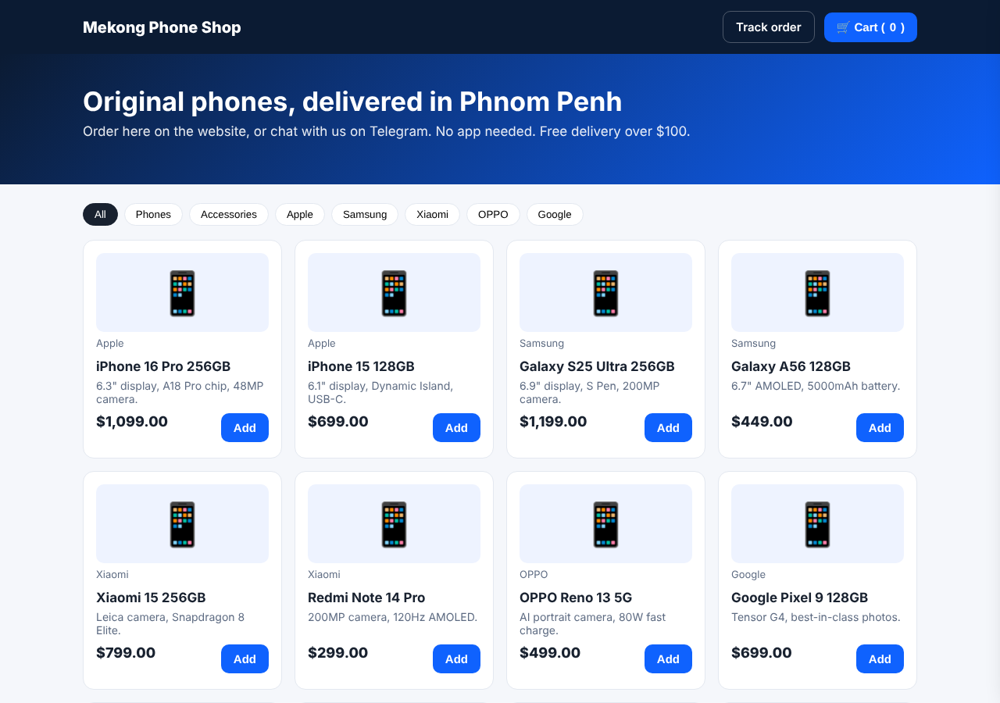
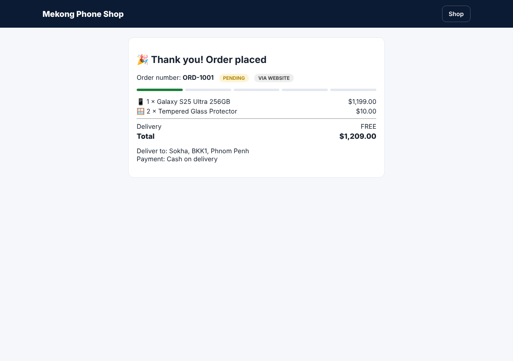

# Mekong Phone Shop: Website + Telegram Ordering

CS 491 Enterprise Application Development, Homework #1.

> "You are a developer, so you have to build a website for your company. You do not build a mobile app to save time, so you build the connection from Telegram to your website so your customers can purchase orders normally."

This project is a phone shop website. Customers can order in **two ways**, and both end up in the **same database**:

| Channel | How the customer orders |
|---|---|
| 🌐 Website | Browse phones, add to cart, check out with name, phone, address and payment method |
| ✈️ Telegram bot | Chat with the shop's bot: browse products, tap to add to cart, check out inside Telegram |

The shop staff use one **admin page** to see every order (from both channels) and change its status. When the status changes, the customer automatically gets a Telegram message.



## Features

- Product catalog with filters (Phones, Accessories, by brand)
- Shopping cart (saved in the browser) and checkout
- Free delivery for orders of $100 or more, otherwise $2
- Order tracking page with a progress bar
- Telegram bot: product list, add/remove items, cart, 3-step checkout, share phone number with one tap, payment choice, order confirmation, "My orders", `/track ORD-1001`
- Website orders can be linked to Telegram with a "Connect Telegram" button, so web customers get updates too
- Admin dashboard: all orders, channel, customer, items, totals, status changes, live stats
- Status updates pushed to the customer on Telegram

## Tech stack

- **Node.js 18+** and **Express** (backend + REST API)
- Plain **HTML, CSS and JavaScript** (frontend, no build step)
- **Telegram Bot API** using long polling (works on a laptop, no public URL needed)
- **JSON file** database (`data/db.json`), created automatically on first run

## How to run

1. Install [Node.js](https://nodejs.org) version 18 or newer.
2. Install packages:
   ```bash
   npm install
   ```
3. Create your settings file:
   ```bash
   cp .env.example .env      # Windows: copy .env.example .env
   ```
4. Create a Telegram bot (optional, the website works without it):
   1. Open Telegram and chat with **@BotFather**.
   2. Send `/newbot`, choose a name and a username ending in `bot`.
   3. BotFather gives you a token like `123456789:AAH...`. Paste it into `.env`:
      ```
      TELEGRAM_BOT_TOKEN=123456789:AAH...
      ```
5. Start the server:
   ```bash
   npm start
   ```
6. Open:
   - Shop: http://localhost:3000
   - Admin: http://localhost:3000/admin.html (password from `.env`, default `admin123`)
   - Your bot: the terminal prints its link, e.g. `https://t.me/your_bot`

## Demo script (for class)

1. **Website order:** open the shop, add a phone, check out. You land on the tracking page.
2. **Telegram order:** open the bot, press **Start**, tap **🛍 Products**, add items, tap **🛒 Cart**, then **✅ Checkout**. Answer name, phone, address, pick payment, confirm.
3. **One database:** open the admin page. Both orders are there, labeled `website` and `telegram`.
4. **Notifications:** change the Telegram order's status to `packing`. The customer's Telegram gets a message right away.
5. **Link a website order:** on a website order's tracking page, tap **Connect Telegram**, press Start. Now that order also gets Telegram updates.

## Project structure

```
server.js            Starts the website (Express) and the Telegram bot
src/db.js            Tiny JSON-file database + sample products
src/shop.js          Business logic shared by website AND bot (pricing, orders, status)
src/telegram.js      Telegram bot (menus, cart, checkout conversation, notifications)
public/index.html    Shop page (products, cart, checkout)  + public/app.js
public/order.html    Order tracking page
public/admin.html    Admin dashboard
public/style.css     Styles
```

See [HOW-IT-WORKS.md](HOW-IT-WORKS.md) for an explanation of the design.

## Screenshots

| Cart | Order tracking | Admin |
|---|---|---|
|  |  |  |
