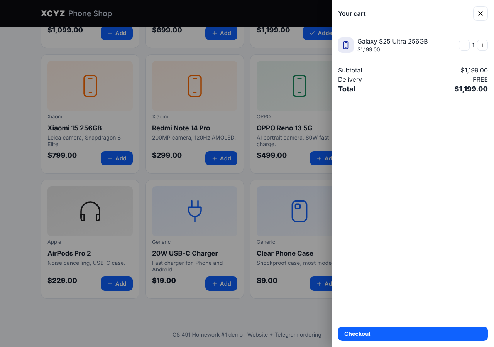
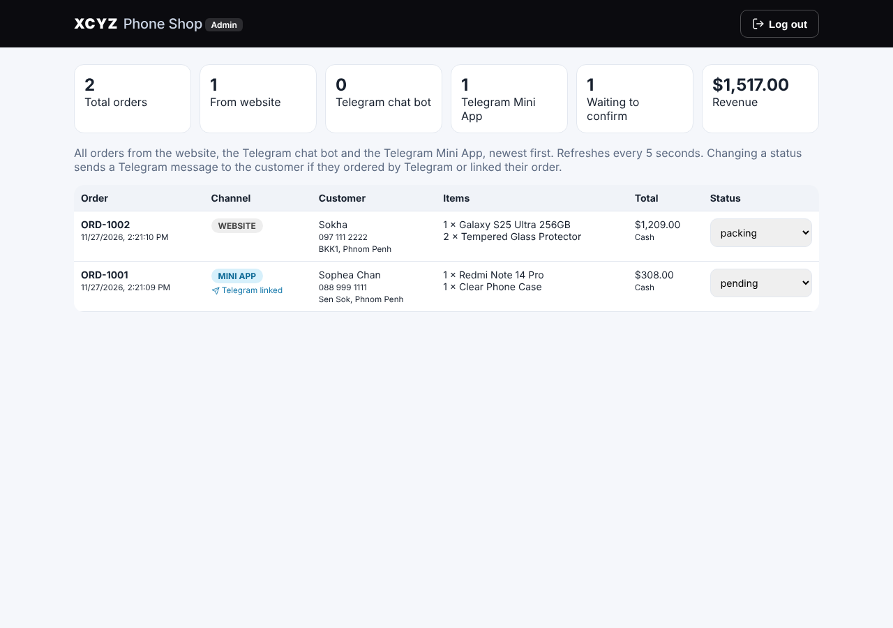
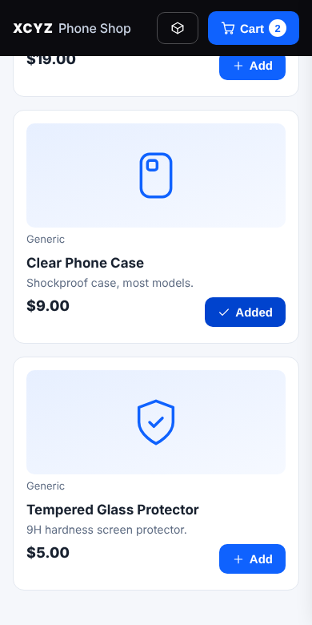
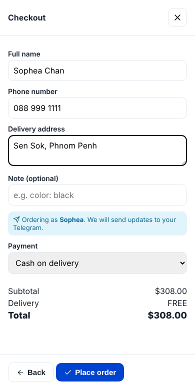
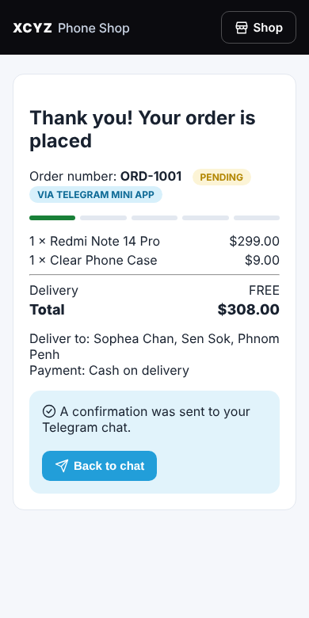

# XCYZ Phone Shop: Website + Telegram Ordering

CS 491 Enterprise Application Development, Homework #1.

> "You are a developer, so you have to build a website for your company. You do not build a mobile app to save time, so you build the connection from Telegram to your website so your customers can purchase orders normally."

This project is a phone shop website. Customers can order in **three ways**, and every order ends up in the **same database**:

| Channel | How the customer orders |
|---|---|
| 🌐 Website | Browse phones in a browser, add to cart, check out |
| 📱 Telegram Mini App | Tap **Shop** in the bot: the same website opens *inside* Telegram, like an app. Telegram tells us who the user is, so their name is filled in and updates arrive in their chat |
| 💬 Telegram chat bot | Chat with the bot: browse products, tap buttons to add to cart, check out by answering questions |

The Mini App is the "no mobile app needed" idea: Telegram becomes the app, and our website is what runs inside it.

The shop staff use one **admin page** to see every order (from both channels) and change its status. When the status changes, the customer automatically gets a Telegram message.


## Features

- Product catalog with filters (Phones, Accessories, by brand)
- Shopping cart (saved in the browser) and checkout
- Free delivery for orders of $100 or more, otherwise $2
- Order tracking page with a progress bar
- Telegram bot: product list, add/remove items, cart, 3-step checkout, share phone number with one tap, payment choice, order confirmation, "My orders", `/track ORD-1001`
- Website orders can be linked to Telegram with a "Connect Telegram" button, so web customers get updates too
- Professional branding: bold minimal "XCYZ" text logo and a consistent SVG icon set (`public/icons.js`), with each product tinted in its brand color
- **Telegram Mini App**: menu button + "Open shop" button, Telegram's bottom "View cart" button and back button, name prefilled from Telegram, order linked to the user's chat automatically, signed `initData` verified on the server
- Admin dashboard: all orders, channel, customer, items, totals, status changes, live stats
- Status updates pushed to the customer on Telegram

## Tech stack

- **Node.js 18+** and **Express** (backend + REST API)
- Plain **HTML, CSS and JavaScript** (frontend, no build step)
- **Telegram Bot API** using long polling (the chat bot works on a laptop with no public URL)
- **Telegram Mini Apps** (`telegram-web-app.js`) for the in-Telegram shop
- **JSON file** database (`data/db.json`), created automatically on first run

## How to run

1. Install [Node.js](https://nodejs.org) version 18 or newer.
2. Install packages:
   ```bash
   npm install
   ```
3. Create your settings file:
   ```bash
   cp .env.example .env      # Windows: copy .env.example .env
   ```
4. Create a Telegram bot (optional, the website works without it):
   1. Open Telegram and chat with **@BotFather**.
   2. Send `/newbot`, choose a name and a username ending in `bot`.
   3. BotFather gives you a token like `123456789:AAH...`. Paste it into `.env`:
      ```
      TELEGRAM_BOT_TOKEN=123456789:AAH...
      ```
   4. Optional: give the bot a profile picture. Send `/setuserpic` to BotFather, pick your bot, and upload `docs/bot-avatar.png`.
5. Start the server:
   ```bash
   npm start
   ```
6. Turn on the **Mini App** (Telegram only opens Mini Apps over **https**):
   1. Install [ngrok](https://ngrok.com/download) and sign up (free), then run in a second terminal:
      ```bash
      ngrok http 3000
      ```
      (Alternative with no account: `cloudflared tunnel --url http://localhost:3000`.)
   2. Copy the `https://....ngrok-free.app` address into `.env`:
      ```
      SITE_URL=https://abcd-1234.ngrok-free.app
      ```
   3. Stop the server (Ctrl+C) and run `npm start` again. The terminal no longer says "Mini App is off".
   4. In Telegram, open your bot and send `/start`. You now see a **Shop** button next to the message box and an **Open shop** button.

   Note: the ngrok address changes each time you restart ngrok, so update `SITE_URL` again when it does.
7. Open:
   - Shop: http://localhost:3000
   - Admin: http://localhost:3000/admin.html (password from `.env`, default `admin123`)
   - Your bot: the terminal prints its link, e.g. `https://t.me/your_bot`

## Demo script (for class)

1. **Website order:** open the shop, add a phone, check out. You land on the tracking page.
2. **Mini App order:** in Telegram open the bot, tap **Shop**. The website opens inside Telegram. Add a phone, tap Telegram's **View cart** button, check out (your name is already filled in). The bot sends a confirmation in the chat.
3. **Chat bot order:** open the bot, press **Start**, tap **🛍 Products**, add items, tap **🛒 Cart**, then **✅ Checkout**. Answer name, phone, address, pick payment, confirm.
4. **One database:** open the admin page. All three orders are there, labeled `website`, `mini app` and `telegram`.
5. **Notifications:** change a Telegram order's status to `packing`. The customer's Telegram gets a message right away.
6. **Link a website order:** on a website order's tracking page, tap **Connect Telegram**, press Start. Now that order also gets Telegram updates.

## Project structure

```
server.js            Starts the website (Express) and the Telegram bot
src/db.js            Tiny JSON-file database + sample products
src/shop.js          Business logic shared by website AND bot (pricing, orders, status)
src/telegram.js      Telegram: chat bot, Mini App buttons, initData verification, notifications
public/index.html    Shop page (products, cart, checkout)  + public/app.js
public/order.html    Order tracking page
public/admin.html    Admin dashboard
public/style.css     Styles
public/icons.js      SVG icon set
```

See [HOW-IT-WORKS.md](HOW-IT-WORKS.md) for an explanation of the design.

## Screenshots

| Cart | Order tracking | Admin |
|---|---|---|
|  |  |  |

Inside Telegram (Mini App):

| Shop | Checkout | Order placed |
|---|---|---|
|  |  |  |
